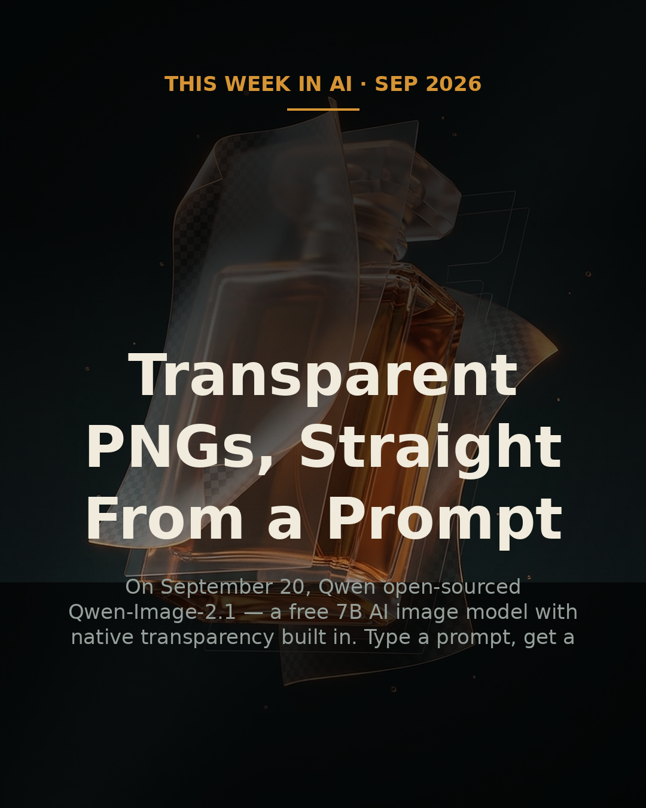
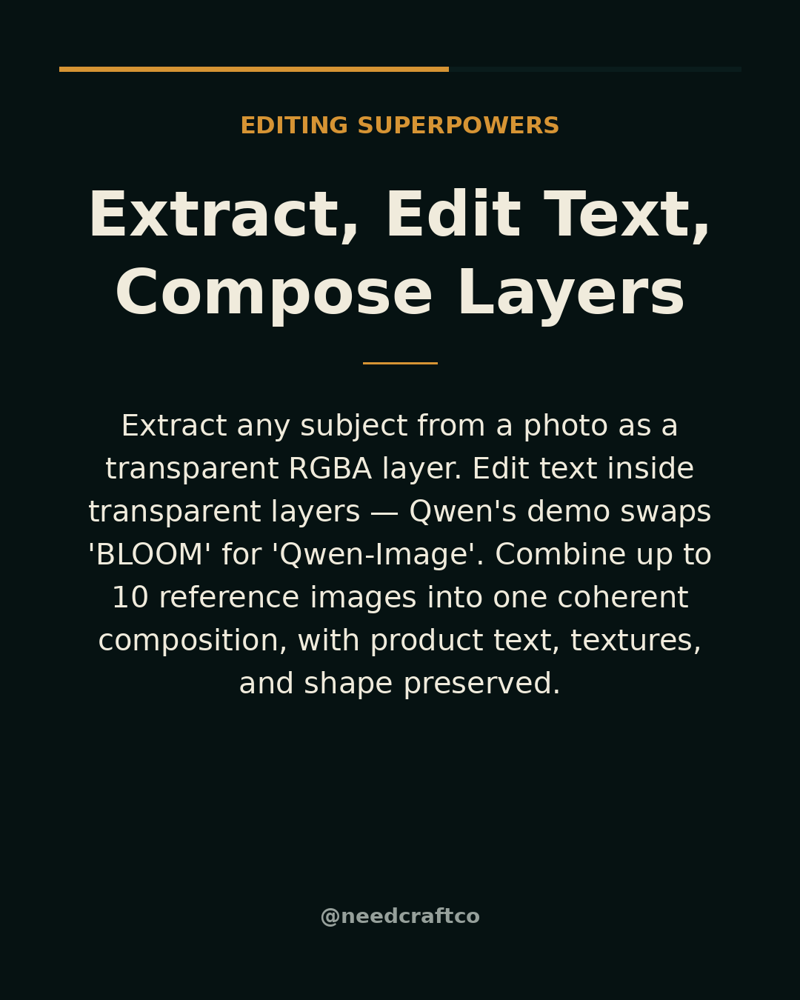
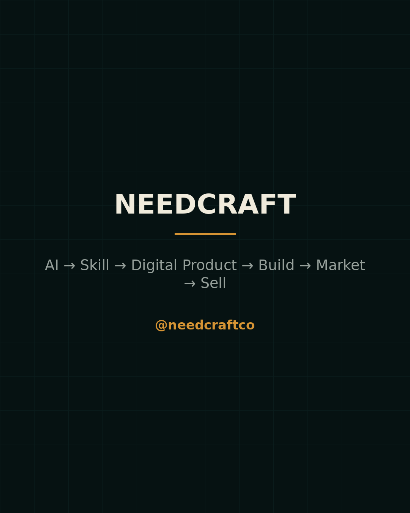

# Carousel, Thumbnail & Visual Design

Design premium, mobile-first social visuals: carousels, thumbnails, prompt cards, and pin
visuals that are readable at a glance on a phone.

## What it is

A working method for briefing and checking visuals — the layout patterns, the type scale,
the 15-point pre-publish gate, and the weekly research habit that keeps the work fresh.
It writes briefs and checks layouts; it does not generate images. You supply your own
image-generation or design tool.

## Who it is for

Anyone who briefs or checks visuals for social posts: a designer, a creator, or an agent
writing visual briefs for an image-generation step. No specialist software is assumed —
you need an image tool, a way to view images at full size and at phone size, and a
contrast checker.

## How to use

1. Read `SKILL.md` (the whole method, including the 15-point visual gate).
2. Write a brief using the eight-field brief format in `SKILL.md`. A filled-in example
   is in `examples/visual-brief-example.md`.
3. Pick a layout pattern (listicle/ranking, tutorial, news-alert, or build-along) and
   sketch the slides.
4. Make the visual with your own tool and palette — the dark editorial palette in the
   skill is a worked example, not a requirement.
5. Run the 15-point gate. One FAIL = revise, never ship. Record one gate line per visual.

## Example

A filled-in visual brief (listicle carousel, 7 slides, 1080x1350) and a before/after
layout example are in `examples/visual-brief-example.md`. Both are illustrative examples
written for this skill.

## Install

Copy this folder into your skills directory (for example, alongside your other skills)
and reference it by name when briefing or checking a visual. No build step, no API key,
no account needed.

## License

MIT — see `LICENSE` in the skill root if present, otherwise the license in the skill
frontmatter applies.

## Disclaimer

This skill designs and checks visuals; it does not guarantee performance, reach, or
sales. A visual that passes the gate can still underperform. Platform dimensions and
behaviour change — re-check sizes against the platform's current specs before shipping a
format you have not used in a while. WCAG contrast figures are cited from WCAG 2.1
Success Criterion 1.4.3 (Level AA).

## Example images — real output

Three cards from a real NeedCraft carousel (Qwen-Image-2.1 launch, Sep 2026), rendered by the NeedCraft carousel builder (1080×1350): cover, text card, brand end card.

