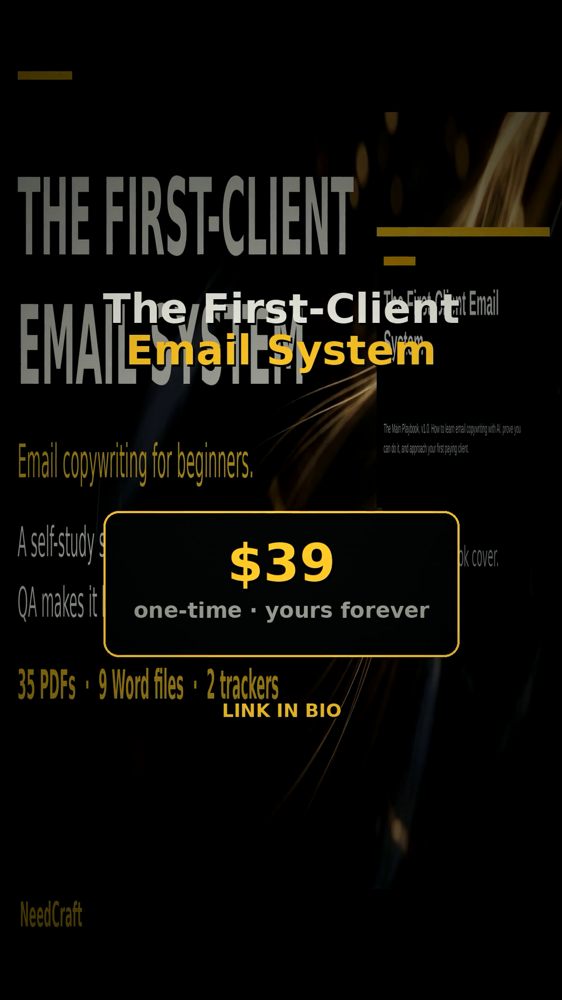
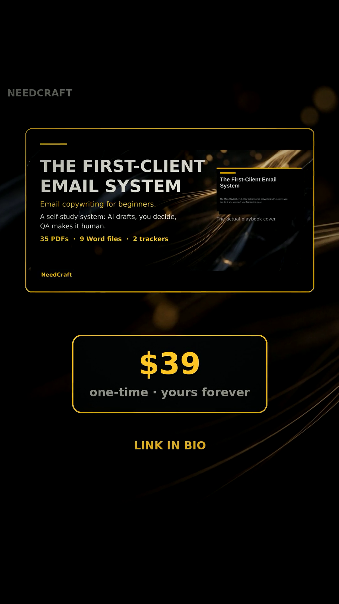

# Post-Publish QA

Verify a social post after publishing it — and prove it, instead of
trusting the publish call's success message.

## What it is

A verification method in three parts: check **before** you publish (right
account, no duplicate, latest caption, good media), verify **after** you
publish (live post re-read byte for byte against the source caption,
media, links, and a non-owner visibility check), and handle failures
without creating duplicates. It works with any publishing tool, because
every check is done against the live surface.

## Who it is for

Anyone who publishes or schedules social posts and wants proof the post
is live, correct, and not duplicated.

## Install

Copy this folder into your skills directory as `post-publish-qa/`.
No dependencies.

## How to use

1. Keep one caption file per post as the single source of truth.
2. Before publishing, fill in `examples/pre-publish-record.md`
   (account checked, duplicate check).
3. After publishing, open the live post and fill in
   `examples/verification-record.md` — text match, media, links,
   formatting, visibility (logged-out view), duplicate check.
4. If a publish result is uncertain, check the live surface first and
   never retry blind: a failed or stuck publish can still land later.
5. Stop after three genuine verification attempts (defined in
   `SKILL.md`: ≥60 s wait, fresh reload, ≥5 min apart) and report the
   blocker.

## Example

`SKILL.md` contains a complete worked example: a tutorial
carousel, from pre-publish record through publish, live verification,
and the PASS record — plus what would have failed it.

## License

MIT. See `SKILL.md` frontmatter.

## Disclaimer

This skill verifies what is visible on the live surface. It cannot verify
platform-internal states (such as reduced distribution), which show up
only in the platform's own insights or support channels.

## Example images — real proof

Frame 28 of NeedCraft reel-01 as the QC pass caught it (broken: overlapping text, cut-off lines, misplaced price box) and after the fix (clean layout). Same frame, before and after — this is the check this skill exists to run.

> **Note:** the price visible in both frames is the example product's price when the reel was made. The frames are shown as the QC record — the price itself is not the point; the layout errors are.
