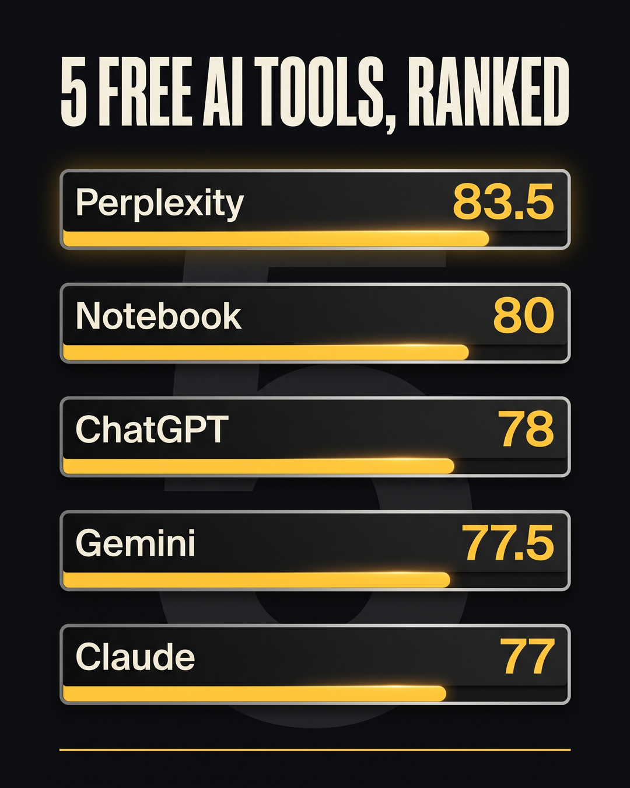

# Top 5 Rankings

Produce Top 5 tool rankings that earn their order: explicit criteria,
verified evidence per tool, a stated method, and an honest hands-on vs
desk-researched label.

## What it is

A method for ranked tool comparisons: seven fixed weighted criteria
(task performance 30%, ease of use 15%, value 15%, features 15%,
reliability 10%, privacy 10%, availability 5%), a research checklist
per tool, hands-on and desk-research protocols, an inline claim ledger,
and a score table the reader can check. Desk-researched rankings cap
task-performance scores at 7/10 and say so on the asset.

## Who it is for

Anyone writing "best X for Y" posts, tool roundups, or comparison
carousels who wants the ranking to survive a skeptical reader checking
the claims.

## Install

Copy this folder into your skills directory as `top5-rankings/`.
No dependencies.

## How to use

1. Fix one task and one input for every tool.
2. Build the claim ledger first (`references/template.md`) — no claim
   reaches the post without a ledger row.
3. Research each tool against the checklist; verify prices on the
   official pages on the day you publish.
4. Score 0–10 per criterion, total /100, publish the score table.
5. Label the asset "Hands-on tested — [date]" or "Desk-researched —
   last checked [DATE]. No hands-on test yet."

## Example

`SKILL.md` contains a complete worked example: five AI image
generators scored 0–10 across all seven criteria, totalled /100, with
a "best for" line each — desk-researched, dated 16 November 2026, with
prices verified that day. `references/template.md` is the blank
research template for the next ranking.

## License

MIT. See `SKILL.md` frontmatter.

## Disclaimer

The weights are the author's method, not a researched fact, and
desk-researched scores are estimates, not measurements. Prices and
free-tier limits change frequently — a ranking is only as current as
its "last checked" date.

## Example images — real output

The full 8-slide "5 Free AI Tools, Ranked" Instagram carousel this skill produced, published live on 16 Nov 2026 ([Instagram post](https://www.instagram.com/p/DfzFntfjqgM/)), plus the Pinterest version. Scores shown are the skill's own verified scores (Perplexity 83.5, NotebookLM 80, ChatGPT 78, Gemini 77.5, Claude 77).

Files: `examples/images/ig-top5-s1-1080x1350.png` … `ig-top5-s8-1080x1350.png` (8 slides, 1080×1350) and `examples/images/pin-top5-1000x1500.png` (Pinterest, 1000×1500).
