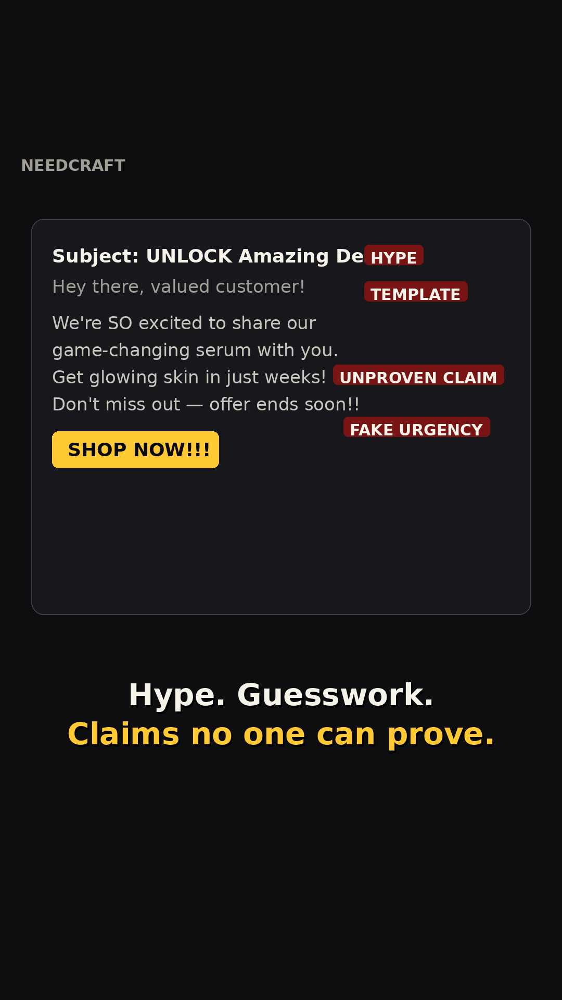

# Video Script & Retention

Write YouTube Shorts and long-form scripts that hold attention — hook first, proof early, one idea per beat, an honest limitation, one call to action.

## What it is

A complete scripting method: Shorts structure (hook → proof → steps → caveat → CTA), a shot-by-shot timing table, a retention-review checklist, a caption spec for 1080×1920, a full worked 60-second Shorts script, a full worked 10-minute long-form script, and YouTube discovery + AI-disclosure rules verified 16 November 2026.

## Who it is for

Creators and small teams scripting their own videos who want a repeatable structure instead of a blank page each time.

## How to use

1. State the video's single promise in one sentence.
2. Draft from the structure in `SKILL.md` — Shorts or long-form.
3. Run the retention-review checklist and the read-aloud test before recording.
4. Check the disclosure rules before uploading any AI-assisted video.

## Example

The worked 60-second script in `SKILL.md` (147 words, ~59 seconds) and the worked 10-minute long-form script are both complete and ready to adapt. A plain-text copy of the Shorts script is in `examples/shorts-script-houseplants.md`.

## Install

This is a skill (a `SKILL.md` playbook), not software. Copy the `video-script-retention/` folder into your agent's skills directory and invoke it when scripting a video, or follow it manually as a checklist.

## License

MIT — see `LICENSE` in the repository root, or treat this file set as MIT-licensed.

## Disclaimer

Duration estimates are rough (±15% around 150 wpm) — the read-aloud test is the measurement. Analytics bands are practitioner guidance, not YouTube-published thresholds. Discovery and disclosure rules are dated 16 November 2026; re-check YouTube's help pages before relying on them.

## Example images — real output

Three storyboard frames from NeedCraft reel-01 (product intro), showing the retention structure in order — hook, problem, CTA (1080×1920).

